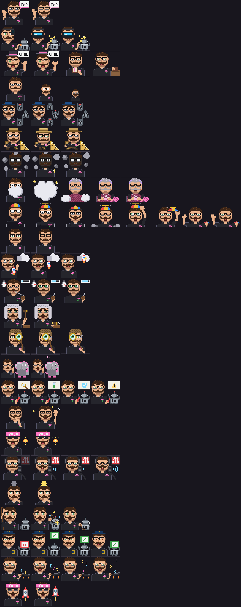

# gentle-emote gallery

Every state of the Gentleman set, shown with the pink accent. Run `/emote <state>` or `/emote demo` to watch them animate in your terminal.



## Redesigned scenes

- **Ask:** the same calm Gentleman face, an open palm and a permanent Y/N bubble. Only the blink, hand position and dynamic accent rim animate. Blocking UI prompts keep this scene visible until answered, cancelled or closed.

- **Remember:** a cupped whispering hand beside Engram's large gray ear, with a complete trunk and a dynamic pink outline.
- **Explore:** the original full-resolution Gentleman face, glasses and curled mustache on a backpacked walker with three leg poses, a flashlight cone and toe/heel footprints kept inside the 48×40 frame.
- **YOLO:** a pointed rocket with a porthole, fins and pulsing exhaust. Thinking in the YOLO set also uses the rocket; normal thinking keeps its light bulb.
- **Super YOLO:** the identical YOLO character with a radiant, pulsing sun instead of the rocket. Preview it with `/emote super-yolo`. YOLO mode still rests on the rocket.

The source colors `#ff00ff`, `#aa00aa` and `#ff80ff` remain runtime recoloring keys. Frames use native 48×40 pixels with no smoothing.

To inspect the animations locally, run `/emote remember`, `/emote explore`, `/emote yolo` and `/emote super-yolo`. With either YOLO mode enabled, also run `/emote think`.

To regenerate a frame contact sheet:

```sh
node scripts/sprites/preview.ts pink docs/gallery.png
```

`npm run sprites` recreates both generated emote sets. When preserving local artwork edits, generate in an isolated copy first and copy back only the intended frames.

Back to the [README](../README.md).

The greeting flies in with a propeller beanie, lands, removes the beanie, and waves with an uncovered head.
